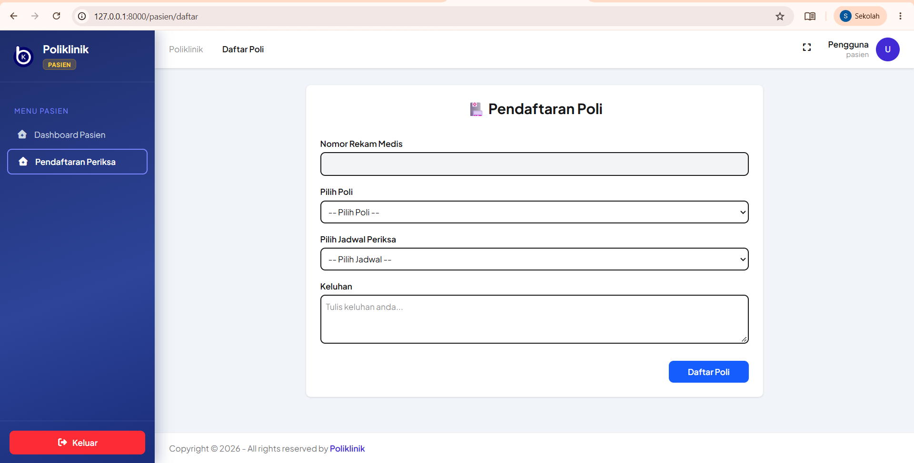
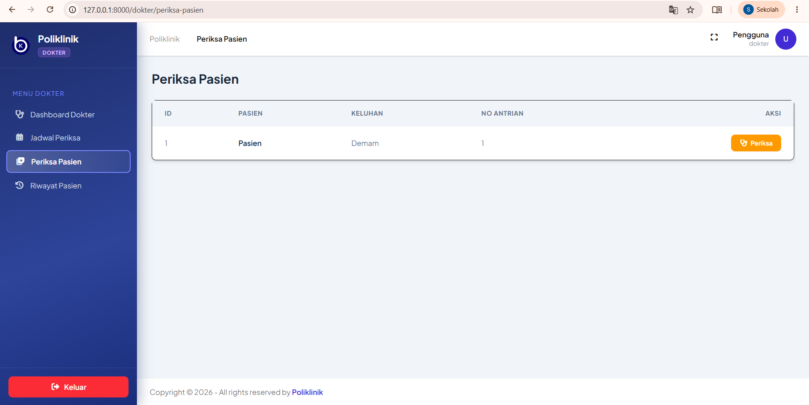
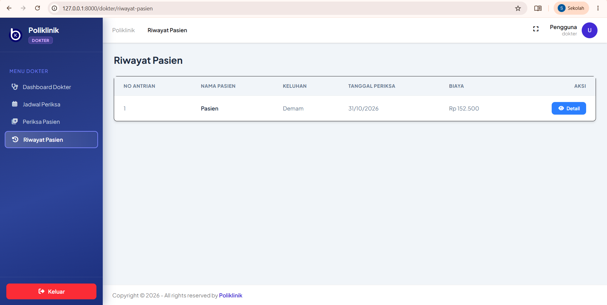

# 🏥 Aplikasi Poliklinik

Aplikasi berbasis web untuk mengelola layanan poliklinik, mulai dari pendaftaran pasien, pengelolaan jadwal dokter, pemeriksaan pasien, hingga riwayat pemeriksaan.

## 🛠️ Teknologi

- Laravel 13
- PHP 8.3
- MySQL
- HTML, CSS, JavaScript

## ✨ Fitur Aplikasi

### 1. Daftar Poli (Pasien)
Pasien dapat melakukan pendaftaran pemeriksaan dengan memilih poli, jadwal dokter, dan mengisi keluhan.



### 2. Periksa Pasien (Dokter)
Dokter dapat melihat daftar pasien yang telah mendaftar dan melakukan pemeriksaan.



### 3. Riwayat Pasien (Dokter)
Dokter dapat melihat riwayat pemeriksaan pasien, termasuk keluhan, tanggal pemeriksaan, dan biaya.



## 📂 Struktur Screenshot

```text
screenshots/
├── daftar-poli.png
├── periksa-pasien.png
└── riwayat-pasien.png
```

## 🚀 Instalasi

1. Clone repository:

```bash
git clone https://github.com/Syahratu015/poliklinik-app.git
```

2. Masuk ke folder project:

```bash
cd poliklinik-app
```

3. Install dependency:

```bash
composer install
```

4. Salin file environment:

```bash
cp .env.example .env
```

5. Generate application key:

```bash
php artisan key:generate
```

6. Sesuaikan konfigurasi database pada file `.env`.

7. Jalankan migrasi:

```bash
php artisan migrate
```

8. Jalankan aplikasi:

```bash
php artisan serve
```

## 👩‍💻 Repository

GitHub: https://github.com/Syahratu015/poliklinik-app

## Screenshot Aplikasi BAB 5

### 1. Daftar Poli (Pasien)


### 2. Periksa Pasien (Dokter)


### 3. Riwayat Pasien (Dokter)
